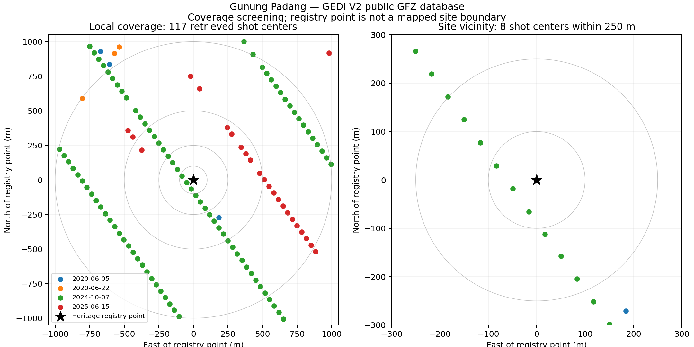

# Gunung Padang GEDI reconnaissance

## Interactive evidence explorer

Live page: **https://decentricity.github.io/gunungpadang/**

The `web/` directory is a self-contained static Three.js viewer with two independent scenes:

1. **Landscape:** a real ~2 km × 2 km Copernicus GLO-30 surface crop, native 66 × 66 posts, plus 117 GEDI footprint rings. Layers, date filters, opacity, vertical exaggeration, camera presets, and footprint inspection are interactive. Rings are draped onto the DSM only to show location; GEDI ellipsoidal heights are retained separately.
2. **Underground hypothesis:** an original four-envelope illustration informed by the paper's Figure 14 and Table 1. Toggle units, move a cutaway, separate the layers, or change transparency. The model is explicitly schematic, not a digitized or georeferenced underground survey. The optional chamber wireframe is unconfirmed and positioned illustratively. No dated construction event is assigned to a mesh.

Original processed GPR, ERT, and seismic figures can be inspected at larger size. Data downloads, source hashes, methods, and both the paper and retraction are accessible. Share links restore camera and layer state. The interface is responsive and retains figures and downloads when WebGL is unavailable.

This is a tool for examining the hypothesis, **not a proof or disproof**. Surface lidar cannot image underground chambers. The currently available processed figures and public surface data cannot independently establish anthropogenic origin or construction age. Reanalysis needs raw geophysical arrays, survey coordinates, inversion settings, core logs, and archaeological sample contexts.

### Build and check

- Serve locally: `python -m http.server 8765 --directory web`, then open http://127.0.0.1:8765/.
- Native terrain preparation: download the two source GeoTIFF URLs in `web/data/provenance.json`, install `requirements.txt`, and run `python prepare_viewer.py /path/to/S07.tif /path/to/S08.tif`.
- Figure preparation: `python prepare_figures.py` uses Poppler and Pillow to reproduce the recorded crops from the archived open-access paper.
- Interaction checks: `npm install`, then `npm test` while the local server runs. `CHROME_PATH`, `BASE_URL`, and `QA_DIR` can override defaults. Tests cover desktop/mobile rendering, toggles, filtering, cutaway, transparency, separation, raw-height inspection, share restoration, source dialogs, downloads, and the WebGL fallback.
- Deployment: copy **only** `web/` into `gunungpadang/` on the current GitHub Pages branch. Fetch/rebase before pushing; never force-push or overwrite unrelated work on the shared site. The research repository is the source of this subtree.

### Credits and publication status

Surface derivative produced using Copernicus WorldDEM-30 © DLR e.V. 2010–2014 and © Airbus Defence and Space GmbH 2014–2018 provided under COPERNICUS by the European Union and ESA; all rights reserved. Accessed 2026-11-11 from the [AWS open data registry](https://registry.opendata.aws/copernicus-dem/). These are DSM heights including vegetation and buildings, relative to EGM2008.

The source paper is Natawidjaja et al. (2023), [doi:10.1002/arp.1912](https://doi.org/10.1002/arp.1912), CC BY 4.0. The PDF was archived on [Wikimedia Commons](https://commons.wikimedia.org/wiki/File:Archaeological_Prospection_-_2023_-_Natawidjaja_-_Geo%E2%80%90archaeological_prospecting_of_Gunung_Padang_buried_prehistoric.pdf); SHA-256 `d6fcfd71deb9f3706180d026c863a6038154a5e9f8b8249c7c92398461d77751`. Figures 1, 9, 10, 12 and 14 are cropped; plotted data are not retouched. The paper was retracted on 18 March 2024 ([notice](https://doi.org/10.1002/arp.1932)); all authors disagree with the retraction. Both records remain visible in the explorer. Three.js r170 is vendored under its MIT license.

---

Initial coverage screen, 2026-11-11. **Feasible for sparse elevation transects near the site.** The retrieved data do not support a continuous bare-earth reconstruction or archaeological interpretation by themselves.

## Observations

- Reference point: latitude -6.993939, longitude 107.056273, from Indonesia's [heritage registry](https://budaya.data.kemdikbud.go.id/cagarbudaya/objek/KB000232). This is a location marker, not a surveyed summit or site boundary.
- Query box: west 107.0472, south -7.0030, east 107.0654, north -6.9849 (approximately 2 km by 2 km).
- NASA CMR returns 17 V002 candidate granules (May 2019–June 2025), and 22 V003 candidates (May 2019–May 2026). Versions overlap; these counts must not be added as distinct passes. Granule intersection alone does not establish shot coverage.
- The GFZ public V2 database returned **117 individual footprints**, on four acquisition dates. These are a processed subset, not a demonstrated exhaustive inventory of all NASA shots.
- Nearest shot center is approximately **52.7 m** from the registry point. There are **3 within 100 m, 8 within 250 m, 25 within 500 m**, and 100 within 1 km. Distances use a local equirectangular approximation.
- All retrieved rows have `quality_flag=1`, `degrade_flag=0`, and sensitivity above 0.90. These flags are screening information, not independent validation of ground detection on steep terrain.
- The eight nearest shots are from 2024-10-07, beam BEAM0101. A single local transect provides limited directional coverage.

## Data and provenance

`cmr-v002.json` and `cmr-v003.json` preserve NASA catalog responses. `candidate-granules.csv` summarizes them. `footprints.csv` preserves the query output; `footprints-by-distance.csv`, `summary.json`, and `coverage.png` are derived locally.

Footprint source: [GFZ global GEDI database documentation](https://gedidb.readthedocs.io/en/latest/user/tiledb_database.html), public bucket `dog-ext.gedidb.gedi-l2-l4-v002.0`, endpoint `https://s3.gfz.de`. Queried 2019-01-01 through 2026-11-11 with no explicit quality filters. The installed client was gedidb 2025.4.25 on Python 3.10. GFZ may apply ingestion filters; coverage and processing differences need auditing before treating absence as a missing NASA observation.

The database was processed using gediDB: Besnard, S., Dombrowski, F., & Holcomb, A., [software DOI](https://doi.org/10.5281/zenodo.13885229). Original NASA product: [GEDI02_A.002](https://doi.org/10.5067/GEDI/GEDI02_A.002). See [NASA access tutorials](https://github.com/nasa/GEDI-Data-Resources).

`elev_lowestmode` is the elevation of the lowest detected waveform mode relative to the reference ellipsoid. It must not be compared directly with map elevations above sea level without vertical datum alignment. Vegetation, slope, geolocation error, and waveform interpretation can affect the inferred terrain.

## Reproduce

Create an isolated Python environment and install `requirements.txt`. Run `python query.py` (internet required), then `python analyze.py`. The query uses the client's default TileDB settings, which allocate large buffers; the initial request took several minutes. Shot numbers are identifiers and must be preserved as integers or strings, never floating point.

Catalog request: `https://cmr.earthdata.nasa.gov/search/granules.json?short_name=GEDI02_A&version=002&bounding_box=107.0472,-7.0030,107.0654,-6.9849&page_size=2000` (repeat with version 003).

## Next research steps

1. Verify a site boundary and align optical imagery with the retrieved footprints.
2. Retrieve RH metrics and original L2A/L1B waveforms for the near-site transect; check algorithm agreement and ground detection.
3. Audit GFZ ingestion filters and compare V3 observations with V2.
4. Compare with a public DEM after horizontal and vertical datum alignment. Do not interpolate sparse transects into apparent terraces or structures.

This public repository records coverage feasibility only. No buried structure, construction history, or age has been inferred.
